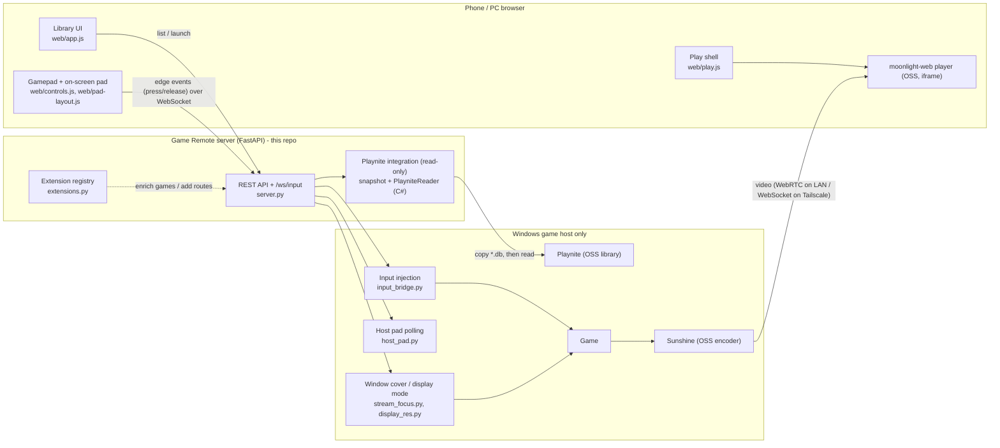

# Game Remote

A self-hosted "couch to anywhere" layer for playing my PC game library from a phone or another PC:
pick a game in a console-style library UI in the browser, launch it on the Windows game host, watch it
through a Sunshine/Moonlight stream, and control it with a physical or on-screen gamepad.

> **What this is and is not.** This is infrastructure for *playing existing games remotely*. It is not a
> game, and it has no gameplay code of its own. What I designed here is the path between the player's thumb
> and the game, plus the stream settings around it. The goal was that remote play still feels responsive
> and readable.

## The problem

Off-the-shelf remote play worked for me at home, but it was poor in three situations:

1. **Outside the home network** (phone on cellular → Tailscale). The picture fell apart at home-LAN
   bitrates, and WebRTC often spent ~15 s on ICE before falling back.
2. **Keyboard-only PC games** played with a gamepad or a touch screen.
3. **Launching and switching games** without touching the host PC.

## Architecture



## Design decisions for comfort and input responsiveness

| Decision | What it does | Why (game-feel angle) | Where |
|---|---|---|---|
| **Per-network stream profiles** | Detects the network from the page host (`*.ts.net` or `100.64.0.0/10`). On LAN: WebRTC/UDP, 60 fps, 1080p at 20 Mbps. Over Tailscale: WebSocket/TCP, 30 fps, 720p at 6-8 Mbps. | Tailscale's MTU is 1280, and home-LAN bitrates over it caused blocky, stalling video. A stable 30 fps that you can read beats a 60 fps that tears apart. | `web/play.js` `streamPath()` |
| **Skip WebRTC-first on remote paths** | Defaults to the same-port WebSocket over Tailscale instead of waiting for ICE. | Removes a ~15 s wait before every remote session. That wait is moonlight-web's ICE timeout, not something I measured. | `web/play.js` (`dataTransport`) |
| **FEC and timeouts (Sunshine config)** | Raised FEC to 20% and ping timeout to 20 s for the cellular/Tailscale path. | Forward error correction recovers lost packets without a retransmit round-trip. On lossy links, the artifacts stop piling up. The cost is bandwidth. | `config/sunshine-stream.conf.example` |
| **Low-latency encoder settings** | Software x264 with `superfast` + `zerolatency`. H.264 only. | `zerolatency` removes look-ahead/B-frame delay. On this host NVENC/QSV were not usable, and x265 was slower and blockier. | `config/sunshine-stream.conf.example` |
| **Host resolution follows stream resolution** | Switches the host display mode to the chosen stream size and restores it afterwards. | Sunshine captures the desktop, so encoding above the host's resolution adds no detail, only cost. | `display_res.py` |
| **Edge-triggered input** | Polls pads every `requestAnimationFrame`. Sends only changes (press/release) over one WebSocket. | Keeps the input stream small and in step with the display. Each event maps 1:1 to a host key down/up. | `web/controls.js` `pollGamepad()` |
| **Duplicate press/release suppression** | Tracks the pressed set on the client and on the server (with a lock). Drops a repeated press or a stray release. | Prevents doubled inputs and stuck keys when the physical pad, the on-screen pad and reconnects overlap. | `input_bridge.py` `inject()`, `web/controls.js` |
| **Release-all on disconnect or blur** | Releases every held key when the socket drops or the tab loses focus. | A network drop must never leave the character running into a wall. | `server.py` `/ws/input`, `web/controls.js` |
| **Dead zones per input source** | XInput stick 12000/32767, winmm ±8000 around center, browser pad 0.45 in game and 0.38 in menus, on-screen stick 0.32. | Kills stick drift. A false input costs more in game than in menus, so the in-game threshold is higher. | `host_pad.py`, `web/controls.js`, `web/app.js` |
| **Console-style menu repeat** | First move fires immediately. Repeats after 280 ms, then every 90 ms. | One tap moves exactly one item, and a hold scrolls fast, like a console UI. | `web/app.js` `gpEdge()` |
| **Start: short vs long press** | Holding Start ≥ 550 ms opens the stream menu and is *not* sent to the game. A short press goes to the game. | The game's pause and the remote's menu share one button, with no accidental menu. | `web/controls.js` (`menuChord`) |
| **Input routing by screen** | In the library, input drives the UI and is never injected into the host. While a menu is open, the on-screen pad drives the menu. Hidden or unfocused tabs ignore the host pad. | The same press never lands in two places. | `web/controls.js`, `web/app.js` `hostPadAllowed()` |
| **Direct host-pad polling** | XInput first, then winmm `joyGetPosEx`. Ignores phantom winmm slots until they show real input. | The browser Gamepad API can stay empty until a gesture, or lose the pad to Steam. Phantom slots otherwise produce a ghost "up". | `host_pad.py` |
| **Per-game key mapping** | Default pad → key/mouse map plus per-game overrides (only diffs are stored). | Keyboard-only PC games become playable on a pad. | `input_bridge.py` |
| **Free-form on-screen pad** | Three saved layouts per orientation. Clusters move together, then each button can move on its own. D-pad/stick toggle. | Lets each player put buttons where the thumbs actually are, on any phone. | `web/pad-layout.js` |
| **Game covers the capture display** | Makes the launched game window borderless over the captured display, and restores it afterwards. | The stream shows only the game, without the desktop chrome. | `stream_focus.py` |

**Measurements:** I did not record any latency, frame-drop or packet-loss measurements for this project.
None are reported here. All numbers in the table are *configuration values*. The improvements were judged
by playing. A next step
would be to measure input-to-photon latency, for example by filming a visible input timestamp at high
frame rate.

## What I wrote vs. what is open-source

**Written by me (this repository):**
- `server.py`: library/launch API, input WebSocket, host-only guard, health
- `input_bridge.py`: key and mouse injection with default and per-game mappings
- `host_pad.py`: XInput/winmm polling, dead zones, phantom-slot filtering
- `stream_focus.py`, `display_res.py`: Win32 window cover and display mode switching
- `paths.py`: install-path remaps (now configured by environment variable)
- `web/`: library UI, play shell, on-screen pad, layout editor
- `tools/PlayniteReader/Program.cs`: C# helper that converts Playnite's LiteDB into JSON
- `extensions.py`, `host_stubs.py`, Docker files: added for this public version

**Used, not written by me (not included here):**
- [Sunshine](https://github.com/LizardByte/Sunshine): host capture and encoder. I only chose its settings.
- [moonlight-web-stream](https://github.com/MrCreativ3001/moonlight-web-stream): browser Moonlight client.
- [Playnite](https://playnite.link/): game library. Read-only access to its database.
- [LiteDB](https://github.com/litedb-org/LiteDB) 4.x (NuGet), [FastAPI](https://fastapi.tiangolo.com/),
  [pynput](https://github.com/moses-palmer/pynput), and [Tailscale](https://tailscale.com/) for remote
  networking.

## Running

### Container (library UI + API, Playnite read-only)

```bash
cp .env.example .env              # set PLAYNITE_LIBRARY_DIR etc.
docker compose up --build -d
open http://127.0.0.1:8765
```

The image is multi-stage. The first stage builds PlayniteReader with the .NET SDK, the second installs the
Python dependencies, and the runtime runs as a non-root user (uid 10001). Compose mounts the Playnite
library read-only, runs with a read-only root filesystem, and drops all capabilities.

### What cannot run in a container

These features need the Windows game host itself. They are **host-only**, and in container mode their
endpoints answer `501`:

- launching and quitting games, and Playnite's own launcher (`/api/launch*`, `/api/quit-game`)
- key/mouse injection and host pad polling (`/api/input/inject`, `/api/input/pad-state`): these need the
  interactive Windows session, XInput/winmm and pynput
- window cover and display mode (`/api/stream-mode`, `/api/display`): Win32 user32
- **Sunshine** (GPU capture and encoding) and **Playnite** themselves: Windows desktop apps

For full functionality, run the server natively on the Windows host:

```powershell
py -3.12 -m pip install -r requirements-host.txt
dotnet build tools/PlayniteReader -c Release
$env:PLAYNITE_READER = "tools\PlayniteReader\bin\Release\net8.0\PlayniteReader.exe"
py -3.12 server.py
```

## Extensions

`extensions.py` defines a deliberately small plugin interface. A module that defines `register(api)` can:

- `api.add_game_enricher(fn)`: attach offline metadata to each game (stored under `game["ext"][name]`)
- `api.add_router(router)`: serve extra endpoints under `/api/ext/<name>/`
- `api.config(key)`: read `GAME_REMOTE_EXT_<NAME>_<KEY>` from the environment, so secrets stay out of code

Extensions are enabled with `GAME_REMOTE_EXTENSIONS=module[,module]` or through the
`game_remote.extensions` entry-point group. A failing extension is reported in `/api/health` and does not
stop the server. Extensions never get write access to the Playnite database.

## Security notes

- Optional API token: set `GAME_REMOTE_TOKEN`.
- Bind to `127.0.0.1` by default. Expose it only through a VPN or a reverse proxy.
- No addresses, host names or credentials are committed. Configure everything through `.env`, which is
  git-ignored.
- LiteDB 4.1.4 has a published advisory, GHSA-3x49-g6rc-c284, about deserializing untrusted data through
  its object mapper. PlayniteReader only opens your own local Playnite database, read-only, as raw
  `BsonDocument`s. Do not point it at untrusted files.

## Tests

```bash
python -m unittest tests.test_paths
```
